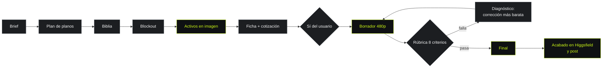

<div align="center">


[](https://docs.claude.com/en/docs/claude-code/skills)
[](https://higgsfield.ai)
[](references/models/seedance-2-5.md)
[](references/quality/qc-rubric.md)
[](references/platform/sources.md)

**Un director audiovisual especializado en Higgsfield para video fotorrealista con continuidad de cine.**<br>
Decide modelo y técnica plano a plano, cotiza antes de gastar, evalúa cada toma y corrige por el camino más barato.

[Qué hace](#qué-hace) · [Cómo dirige](#cómo-dirige) · [Instalación](#instalación) · [Uso](#uso) · [Arquitectura](#arquitectura) · [Modelos](#modelos) · [Calidad](#control-de-calidad) · [Fuentes](#fuentes)

</div>

---

## Qué hace

Generar video con IA suele parecer una tragamonedas: se regenera hasta que algo sale, la cara cambia entre planos y los créditos se van en pruebas. Esta skill convierte a Claude Code en el **director, director de fotografía y supervisor de continuidad** de una producción hecha **exclusivamente con Higgsfield**. Toma las decisiones creativas y técnicas con base verificable y deja la ejecución en el conector de Higgsfield y en sus [skills](https://github.com/higgsfield-ai/skills) y workflows oficiales.

| Problema | Cómo lo resuelve |
|---|---|
| La cara, la ropa o el set cambian entre tomas | Hojas de personaje como referencias, frame plates por set, descripciones fijas, máximo ~9 referencias por clip, empalmes con extensión o con plates (nunca con `start_image` en la costura) |
| Encuadre y timing al azar | Plan de planos con lente, movimiento e intención, y un blockout (Blender, 3D Jutsu o Genjutsu) como `video_references` |
| Prompts genéricos que «parecen IA» | Estructura oficial por modelo, vocabulario físico de cámara y luz, actuación con microgestos y redacción positiva |
| Elegir modelo por moda | Un router por tipo de plano: Seedance 2.5, Cinema Studio 4.0/3.5, Kling 4.0, Omni Flash e imagen |
| Créditos gastados en pruebas | Cotización obligatoria, borrador 480p finalizable, escalera de costos, presupuesto con reserva y libro de gasto |
| No saber si una toma sirve | Rúbrica de 8 criterios con umbrales por tipo de plano y un diagnóstico de síntoma → causa → corrección más barata |
| Arreglar obliga a regenerar | Correcciones dentro de Higgsfield: re-iluminar, re-etalonar, extender, escalar 1:1, lip-sync, reencuadrar |

> [!IMPORTANT]
> **Nunca genera sin un sí explícito** en el chat. Cotizar es gratis y siempre va primero. Solo usa la imagen de personas reales con su consentimiento. Por MCP o CLI, **todo gasta créditos**: lo «ilimitado» de los planes solo funciona en la web de Higgsfield.

## Cómo dirige



<sub>Gris: 0 créditos · lima: consume créditos</sub>

Cada etapa tiene una puerta de salida (`references/direction/pipeline.md`). El usuario aprueba en tres puntos: brief, blockout más activos, y cada gasto de video.

## Instalación

| Requisito | Para qué |
|---|---|
| [Claude Code](https://docs.claude.com/en/docs/claude-code) | Ejecutar la skill |
| Conector MCP o CLI de [Higgsfield](https://higgsfield.ai) con un plan de pago | Cotizar, subir y generar |
| [Blender](https://www.blender.org/download/) 5.1+ con el [MCP oficial](https://www.blender.org/lab/mcp-server/) | Blockout (opcional; alternativas: 3D Jutsu, Genjutsu) |
| `ffmpeg` y `ffprobe` | `scripts/frames.sh` |

```bash
git clone https://github.com/Dvanielx03/higgsfield-photorealistic-filmmaking.git \
  ~/.claude/skills/higgsfield-photorealistic-filmmaking
```

Para desarrollarla en Windows sin duplicar archivos, clona donde quieras y enlaza:

```powershell
New-Item -ItemType Junction -Path "$env:USERPROFILE\.claude\skills\higgsfield-photorealistic-filmmaking" -Target "<ruta-del-clon>"
```

## Uso

La skill se activa sola al pedir producir o mejorar un video con Higgsfield. Ejemplos:

```text
Tengo este guion de 40 s para Reels. Arma el plan de planos y dime qué modelo usarías en cada plano y cuánto costaría.
```
```text
Haz las hojas de personaje de los dos protagonistas con estas fotos (tienen su consentimiento) y la biblia de continuidad.
```
```text
Escribe la ficha de la sección S2 para Seedance 2.5 con el blockout y las hojas, y cotiza el borrador.
```
```text
Evalúa este borrador con la rúbrica y dime la corrección más barata.
```
```text
Este plano está bien, pero la luz cambia respecto al anterior. ¿Cómo lo arreglo sin regenerar?
```

## Arquitectura

**Carga progresiva:** `SKILL.md` es un router corto con las reglas innegociables, el ciclo de dirección y un mapa de qué módulo cargar en cada momento. Claude solo lee el módulo de la etapa en curso y la ficha del modelo elegido.

```text
higgsfield-photorealistic-filmmaking/
├── SKILL.md                         Rol, innegociables, ciclo, mapa de módulos, valores por defecto
├── references/
│   ├── platform/
│   │   ├── capabilities.md          Qué existe y qué no; herramientas del conector; workflows oficiales
│   │   ├── plan-and-credits.md      Plan Plus, créditos, ilimitados (solo web), cuánto video da
│   │   └── sources.md               De dónde sale cada regla y qué falta verificar
│   ├── direction/
│   │   ├── pipeline.md              Etapas, puertas de salida, atajos, carpetas del proyecto
│   │   ├── shot-design.md           Tamaños, lentes, movimiento motivado, luz, 9:16, ritmo
│   │   ├── identity-and-assets.md   Hojas, Elements, Soul ID, consentimiento, sets, props
│   │   ├── continuity.md            Empalmes, raccords, luz y color entre clips
│   │   └── blockout.md              Blender, 3D Jutsu, Genjutsu, plugin de Blender
│   ├── models/
│   │   ├── router.md                Árbol de decisión y matriz de costos
│   │   ├── seedance-2-5.md          Esquema, guía oficial, reglas de clip, voz, edición
│   │   ├── cinema-studio.md         4.0 (light_custom), 3.5 (multi_prompt), 3.0, Image 2.5
│   │   ├── kling-omni-veo.md        Kling 4.0/3.0, Gemini Omni Flash 1.2, Veo 3.1
│   │   ├── image-models.md          GPT Image 2.6, Seedream, Nano Banana, Soul, Cinema Image
│   │   └── post-tools.md            Re-iluminar, re-etalonar, escalar, lip-sync, sonido
│   ├── prompting/
│   │   ├── principles.md            Reglas universales y vocabulario de fotorrealismo
│   │   └── templates.md             Plantillas A–I por caso y modelo
│   ├── quality/
│   │   ├── qc-rubric.md             8 criterios, umbrales y decisión
│   │   └── diagnosis.md             Síntoma → causa → corrección, escalera de estrategias
│   └── production/
│       └── cost-protocol.md         Checklist previo, reglas de gasto, presupuesto
├── templates/                       biblia · plan-de-planos · prompt-card · qc-report · presupuesto
├── scripts/frames.sh                first · last · at · sheet · compare · info
└── assets/banner.svg
```

## Modelos

| Plano | Modelo | Por qué |
|---|---|---|
| Sección multiplano con personas y blockout | **Seedance 2.5** `omni_reference` | Video, imagen y audio de referencia; borrador finalizable; edición y extensión |
| Luz idéntica fijada por parámetro | **Cinema Studio 4.0** + `light_custom` | Único control de luz verificado por parámetro |
| Un prompt por plano con duraciones | **Cinema Studio 3.5** `multi_prompt` | Multiplano explícito (con `prompt_language: "en"`) |
| Plano único desde un fotograma aprobado | **Kling 4.0** i2v | Unas 3 veces más barato a 720p |
| Ambiente sin personas | **Gemini Omni Flash 1.2** | Barato, audio nativo |
| Hojas y fotogramas | **GPT Image 2.6** · Seedream 5.5 · Nano Banana Pro · Soul 2.0 | Según el método oficial `character-sheet` |

> [!WARNING]
> Catálogo, parámetros y precios cambian cada semana. La skill obliga a re-consultar el esquema (`models_explore`) y a re-cotizar antes de cada producción; las cifras del repositorio son una foto con fecha. Los **conflictos entre fuentes** (por ejemplo, la sintaxis `@Image1` frente a `@Image 1`, o las fotos que pide Soul ID) están marcados en cada módulo con la opción que se toma.

## Control de calidad

| # | Criterio | # | Criterio |
|---|---|---|---|
| 1 | Fotorrealismo | 5 | Naturalidad de movimientos |
| 2 | Coherencia física | 6 | Calidad cinematográfica |
| 3 | Consistencia de personajes | 7 | Fidelidad a las referencias |
| 4 | Continuidad narrativa y visual | 8 | Intención creativa |

Cada criterio vale de 0 a 2. Se aprueba con 14/16 o más y ningún 0. Un 0 en identidad, física o fidelidad descarta la toma y obliga a diagnosticar. Si el mismo fallo aparece dos veces, se cambia de estrategia en vez de volver a tirar los dados.

<details>
<summary><strong>Escalera de correcciones (de barata a cara)</strong></summary>

<br>

1. Arreglo en post sin regenerar.
2. Corrección dentro de Higgsfield (`lighting-hf`, `grade-hf`, `reframe`, `sync_so`, `video_extension`).
3. Corregir una referencia y repetir el borrador.
4. Corregir una frase del prompt y repetir el borrador.
5. Corregir el blockout y repetir el borrador.
6. Cambiar de técnica: dividir, simplificar o cambiar de modelo.

</details>

## Fuentes

- **Conector de Higgsfield:** esquemas, cotizaciones y workflows oficiales (`drama-ads`, `character-sheet`, `angles-hf`, `lighting-hf`, `grade-hf`, `higgsfield-enhance-video`, `video-sound-design`, `video-montage`).
- **Documentación de Higgsfield:** centro de ayuda, [guía de prompting de Seedance 2.5](https://higgsfield.ai/blog/seedance-2-5-prompting-guide), [guía de Cinema Studio 4.0](https://higgsfield.ai/blog/cinema-studio-4-0-complete-guide), [planes](https://higgsfield.ai/pricing.md) y [skills oficiales](https://github.com/higgsfield-ai/skills).
- **Guías de los fabricantes:** Kling, Gemini Omni, Veo, Nano Banana y GPT Image.
- **Práctica:** Thomas Lundström, [*Claude + Blender Is The Best Way To Make AI Commercials*](https://www.youtube.com/watch?v=jc0Qh09Qrlo).

Lista completa, con lo que aporta cada fuente y lo pendiente de verificar, en [`references/platform/sources.md`](references/platform/sources.md).

---

<sub>Proyecto independiente, sin afiliación con Higgsfield AI. Higgsfield y su logotipo son marcas de sus respectivos titulares y se usan solo para indicar compatibilidad.</sub>
