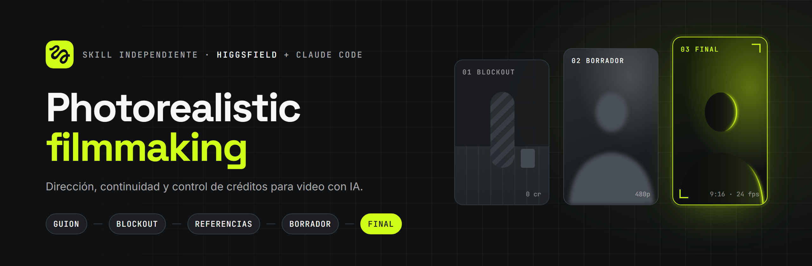
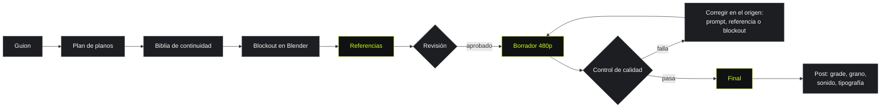

<div align="center">



[](https://docs.claude.com/en/docs/claude-code/skills)
[](https://higgsfield.ai)
[](https://flow.google.com)
[](#flujo-de-producción)
[](references/model-matrix.md)

**Dirección, continuidad y control de costos para producir video fotorrealista con IA.**<br>
Convierte un guion en planos, referencias y prompts de cine, y no gasta un crédito sin aprobación.

[Qué resuelve](#qué-resuelve) · [Flujo](#flujo-de-producción) · [Instalación](#instalación) · [Uso](#uso) · [Modelos](#modelos) · [Estructura](#estructura) · [Fuentes](#fuentes)

</div>

---

## Qué resuelve

Generar video con IA suele parecer una tragamonedas: se regenera hasta que algo sale bien, la cara cambia entre planos y los créditos se van en pruebas. Esta skill hace de **departamento de dirección y continuidad** dentro de Claude Code. Cierra cada decisión creativa antes de generar y deja la ejecución en manos de las [skills oficiales de Higgsfield](https://github.com/higgsfield-ai/skills).

| Problema | Cómo lo resuelve la skill |
|---|---|
| La cara, la ropa o el set cambian entre tomas | Biblia de continuidad con descripciones fijas, una referencia por set y por estado, y relevo del último fotograma |
| El encuadre y el timing salen al azar | Blockout en Blender con lentes y duraciones reales, usado como video de referencia |
| Prompts genéricos que «parecen IA» | Plantillas por modelo con cámara física, luz motivada, piel, actuación y física |
| Créditos gastados en pruebas | Cotización obligatoria, borrador a 480p, corrección en el origen del error y libro de gasto |
| Dos personas con dos herramientas que no casan | Reparto Higgsfield / Google Flow con referencias compartidas y etalonaje común |
| Texto y efectos pedidos al modelo | Cada efecto se clasifica antes: lo que es gráfico o filtro va a posproducción |

> [!IMPORTANT]
> La skill **nunca genera sin autorización explícita** en el chat. Cotizar es gratis y siempre va primero. Solo usa la imagen de personas reales con su consentimiento.

## Flujo de producción



<sub>Gris: 0 créditos · lima: consume créditos</sub>

| Etapa | Entregable | Créditos |
|---|---|---|
| Plan de planos | Cada plano con duración en segundos enteros, lente, movimiento, acción y herramienta | 0 |
| Biblia de continuidad | Personajes, vestuario, sets, props, luz, paleta y ejes | 0 |
| Blockout | Video gris por sección con el timing exacto, y placas grises de cada set | 0 |
| Referencias | Hojas de personaje, sets fotorrealistas desde las placas, props | bajo |
| Borrador | 480p, con el mismo prompt y las mismas referencias que el final | ~3 cr/s |
| Final | Resolución de entrega | ~7 cr/s a 720p |
| Post | Etalonaje común, sonido propio, motion graphics y máscaras | 0 |

> [!TIP]
> Un plano fijo y aislado (una ficha, un inserto) no necesita blockout: basta con un **fotograma clave aprobado** como imagen de inicio, o con una imagen y parallax en post.

## Instalación

**Requisitos**

| | |
|---|---|
| [Claude Code](https://docs.claude.com/en/docs/claude-code) | App de escritorio (pestaña Code) o CLI |
| Conector o CLI de [Higgsfield](https://higgsfield.ai) | Con las [skills oficiales](https://github.com/higgsfield-ai/skills) para ejecutar generaciones |
| [Blender](https://www.blender.org/download/) 5.1+ con el [MCP oficial](https://www.blender.org/lab/mcp-server/) | Para el blockout (opcional pero recomendado) |
| `ffmpeg` y `ffprobe` | Para `scripts/frames.sh` |

**Instalar como skill personal**

```bash
git clone https://github.com/Dvanielx03/higgsfield-photorealistic-filmmaking.git \
  ~/.claude/skills/higgsfield-photorealistic-filmmaking
```

**Para trabajar sobre el repositorio y seguir mejorándolo** (Windows): clona donde quieras y enlaza la carpeta con un junction. Así Claude carga siempre la versión del repositorio.

```powershell
git clone https://github.com/Dvanielx03/higgsfield-photorealistic-filmmaking.git "$env:USERPROFILE\Documents\02-Contenido\higgsfield-photorealistic-filmmaking"
New-Item -ItemType Junction -Path "$env:USERPROFILE\.claude\skills\higgsfield-photorealistic-filmmaking" -Target "$env:USERPROFILE\Documents\02-Contenido\higgsfield-photorealistic-filmmaking"
```

> [!NOTE]
> La skill se activa sola cuando pides producir un video cinematográfico de varios planos, mantener la continuidad entre tomas, escribir prompts de cine o controlar el gasto. También puedes nombrarla directamente.

## Uso

Ejemplos de lo que se le pide a Claude Code:

```text
Convierte este guion en plan de planos y biblia de continuidad para un video 9:16 de 45 s.
```
```text
Arma el blockout en Blender de las secciones S2 y S6 y expórtalo con su duración exacta.
```
```text
Escribe el prompt de la sección S2 para Seedance 2.5 usando las referencias de la biblia y cotiza el borrador.
```
```text
Revisa este borrador con la rúbrica de control de calidad y dime si va a final o qué hay que corregir.
```

**Script de fotogramas** para el relevo entre tomas y el control de calidad:

| Comando | Para qué |
|---|---|
| `bash scripts/frames.sh last toma.mp4 last.png` | Último fotograma real, para usarlo como `start_image` de la toma siguiente |
| `bash scripts/frames.sh first toma.mp4 first.png` | Primer fotograma |
| `bash scripts/frames.sh at toma.mp4 3.5 frame.png` | Fotograma en un instante |
| `bash scripts/frames.sh sheet toma.mp4 sheet.png 2` | Hoja de contacto con marcas de tiempo (2 fps) |

## Modelos

Resumen de la matriz completa en [`references/model-matrix.md`](references/model-matrix.md), con costos cotizados en 9:16.

| Uso | Modelo | Por qué |
|---|---|---|
| Secciones multiplano con personajes | **Seedance 2.5** (`omni_reference`) | Sigue un video de blockout, admite hasta 30 imágenes de referencia y tiene borrador 480p finalizable |
| Plano único desde un fotograma aprobado | Seedance 2.5 `start_image` · **Kling 4.0** | Kling cuesta unas 3 veces menos a 720p cuando el fotograma ya fija cara y luz |
| Control explícito de cámara y óptica | **Cinema Studio 4.0** | Ids de cámara, lente, apertura, luz, era y paleta |
| Planos que casan con Google Flow | **Gemini Omni Flash 1.2** | Es el modelo actual de Flow y también está en Higgsfield |
| Hojas de personaje | **Seedream 5.0 Pro** | Recomendado para caras y hojas |
| Ediciones y variantes de imagen | **GPT Image 2.6** | El más barato, hasta 16 referencias |

> [!WARNING]
> El catálogo y los precios cambian cada semana. La skill obliga a re-consultar el modelo y a re-cotizar antes de cada producción; las cifras del repositorio son una foto con fecha. En Google Flow, **Veo 3.1 Fast/Quality se retira el 5-dic-2026**.

### Higgsfield y Google Flow en paralelo

| Va en Higgsfield | Va en Google Flow |
|---|---|
| Todo plano con la cara de los protagonistas | Fotogramas clave y referencias de sets (imágenes sin costo de video) |
| Secciones multiplano con blockout | Sets vacíos, ambientes e insertos sin caras |
| Diálogo a cámara y lip-sync | Planos resolubles con Omni Flash 1.2 sin personas reales |

Las mismas referencias se usan en las dos herramientas, todo se conforma a 24 fps y se etaloniza junto. Detalle en [`references/flow-handoff.md`](references/flow-handoff.md).

## Estructura

```text
higgsfield-photorealistic-filmmaking/
├── SKILL.md                     Punto de entrada: reglas, flujo y selección de modelo
├── references/
│   ├── workflow.md              Cada etapa con entradas, salidas y criterio de salida
│   ├── model-matrix.md          Modelos por tipo de plano, capacidades y costos
│   ├── prompt-templates.md      Plantillas por modelo y por tipo de referencia
│   ├── continuity.md            Identidad, vestuario, sets, luz, cámara y relevo
│   ├── qc-cost-protocol.md      Checklist previo, rúbrica y árbol de decisión
│   ├── flow-handoff.md          Trabajo en paralelo con Google Flow
│   └── sources.md               De dónde sale cada regla
├── templates/
│   ├── biblia.md                Biblia de continuidad del proyecto
│   ├── plan-de-planos.md        Secciones, planos y relevos
│   └── presupuesto.md           Presupuesto aprobado y libro de gasto
├── scripts/
│   └── frames.sh                Primer y último fotograma, hoja de contacto
└── assets/
    ├── banner.html              Fuente editable del banner
    └── banner.png
```

<details>
<summary><strong>Cómo encaja con las skills oficiales de Higgsfield</strong></summary>

<br>

| Necesidad | Quién la cubre |
|---|---|
| Generar, cotizar, subir medios, consultar modelos | `higgsfield-generate` / conector MCP de Higgsfield |
| Identidad facial para imágenes | `higgsfield-soul-id` |
| Plan de planos, biblia, blockout, prompts de cine, presupuesto, control de calidad, relevo entre tomas, reparto con Flow | **esta skill** |

Las skills oficiales (v0.14.0) no documentan plan de planos, continuidad, presupuesto, control de calidad ni relevo de fotogramas como flujo general. Esta skill cubre esos huecos sin duplicar la ejecución.

</details>

## Fuentes

- Thomas Lundström, [*Claude + Blender Is The Best Way To Make AI Commercials*](https://www.youtube.com/watch?v=jc0Qh09Qrlo) (2026), su guía de instalación y su PDF de prompts. Origen del blockout, las secciones, el borrador y la estructura del prompt de sección.
- [Skills oficiales de Higgsfield](https://github.com/higgsfield-ai/skills) (v0.14.0) y catálogo del conector de Higgsfield.
- Ayuda oficial de [Google Flow](https://support.google.com/flow/answer/16352836), la [guía de prompts de Gemini Omni](https://deepmind.google/models/gemini-omni/prompt-guide/) y la [guía de prompts de Veo](https://docs.cloud.google.com/vertex-ai/generative-ai/docs/video/video-gen-prompt-guide).

Lista completa, con lo que sale de cada fuente y lo que queda por verificar, en [`references/sources.md`](references/sources.md).

---

<sub>Proyecto independiente, sin afiliación con Higgsfield AI ni con Google. Higgsfield y su logotipo son marcas de sus respectivos titulares y se usan solo para indicar compatibilidad.</sub>
